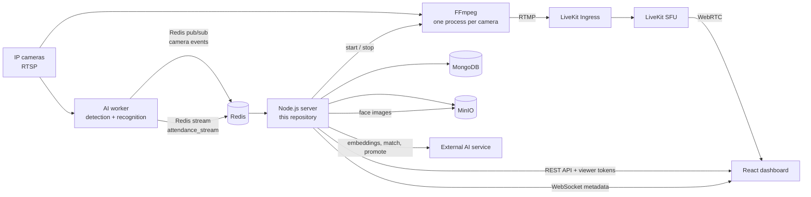
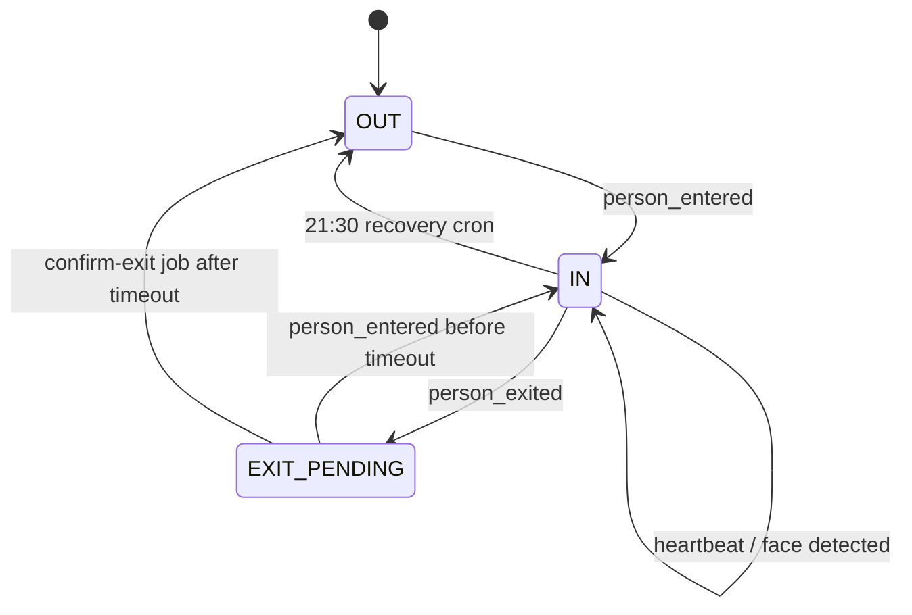

# Live Face Tracker — Backend Server

Real-time face-recognition attendance, presence tracking, and live camera monitoring.

This repository is the Node.js + TypeScript **control plane and REST API** for the Live Face Tracker platform. It converts recognition events from an external AI worker into durable attendance sessions, maintains live presence state, serves reporting APIs, pushes dashboard notifications over WebSocket, and issues view-only LiveKit credentials for camera streams.

> **Scope:** this repository contains the backend only. The React dashboard, Python AI worker, LiveKit server, MongoDB, Redis, and MinIO are separate services.


---

## Table of contents

- [Overview](#overview)
- [Key features](#key-features)
- [Architecture](#architecture)
- [Tech stack](#tech-stack)
- [Repository structure](#repository-structure)
- [Getting started](#getting-started)
- [Configuration](#configuration)
- [API reference](#api-reference)
- [Realtime and Redis contracts](#realtime-and-redis-contracts)
- [Attendance lifecycle](#attendance-lifecycle)
- [Data model](#data-model)
- [Background jobs and schedulers](#background-jobs-and-schedulers)
- [Deployment](#deployment)
- [Security checklist](#security-checklist)
- [Troubleshooting](#troubleshooting)
- [Documentation](#documentation)
- [Contributing](#contributing)
- [License](#license)

---

## Overview

Live Face Tracker answers three questions in real time:

1. **Who is in front of the camera?** An AI worker detects and recognizes faces, then publishes events.
2. **Who is currently inside?** The backend maintains a presence state machine per employee.
3. **How long did each person work?** Attendance sessions are opened on entry, closed on exit, and aggregated into reports.

The server deliberately **does not process video frames**. Video follows a separate media path, while this server handles metadata, state, storage, and APIs:

```text
Video:     RTSP camera -> FFmpeg -> LiveKit Ingress -> LiveKit SFU -> Browser (WebRTC)
Metadata:  RTSP camera -> AI worker -> Redis -> this server -> MongoDB + WebSocket -> Dashboard
```

This separation keeps the Node.js process lightweight under load and lets the media plane scale independently.

---

## Key features

| Area | Capabilities |
| --- | --- |
| **Face enrollment** | Register employees with 3–10 face images, generate embeddings through the external AI service, and store images in MinIO. |
| **Unknown identities** | Capture unknown faces, maintain pose-aware identity profiles, export embeddings to the AI cache, merge duplicates, soft-delete, and promote an unknown person to an employee. |
| **Live presence** | Per-employee state machine (`IN`, `OUT`, `EXIT_PENDING`), entry/exit event handling, heartbeat updates, and delayed exit confirmation via BullMQ. |
| **Attendance** | Attendance sessions with entry/exit timestamps, camera codes, confidence, and duration. Supports current state, timelines, monthly summaries, calendars, and reports. |
| **Reporting** | Daily, monthly, and custom reports; late/early/missing-exit flags; CSV and XLSX exports, with optional async jobs for per-employee exports. |
| **Live camera** | Camera registry, FFmpeg start/stop control, LiveKit Ingress creation, per-camera health watchdog, and subscribe-only viewer tokens. |
| **Realtime UI** | WebSocket broadcasts for recognition notifications, camera stream-start events, and camera online/offline status. |
| **Authentication** | JWT access and refresh tokens, argon2 password hashing, browser cookies, Bearer tokens, and service tokens for internal workers. |
| **Operations** | Zod request validation, Pino structured logging, centralized error handling, nightly attendance recovery cron, and configurable upload limits. |

---

## Architecture

### System context



### Video path

1. The dashboard calls `POST /api/v1/cameras/:code/start`.
2. The server creates a LiveKit Ingress and spawns one FFmpeg process for that camera.
3. FFmpeg pulls the camera's RTSP URL and publishes H.264 over RTMP to LiveKit.
4. LiveKit forwards the stream to browsers over WebRTC.
5. A watchdog tracks FFmpeg output and publishes camera health to Redis.
6. The dashboard fetches a short-lived, subscribe-only LiveKit token and joins the room.

### Metadata path

1. The AI worker processes the same camera feed independently.
2. Recognition events are published to Redis using **two independent contracts**:
   - **Pub/Sub** for live UI notifications, on `live-face-tracker:camera-events:<camera_code>`.
   - **Redis Stream** for attendance state changes, on `attendance_stream`.
3. This server consumes both, updates MongoDB, and broadcasts UI notifications over WebSocket.
4. The dashboard reads REST APIs for durable data and WebSocket events for live updates.

> Architectural decisions are documented in [`docs/bugs/decisions.md`](docs/bugs/decisions.md). The core principles are: Node.js is not a media server, WebSocket carries metadata only, and AI events annotate specific video frames (`frameTs`) rather than carrying video themselves.

---

## Tech stack

| Layer | Technology | Used for |
| --- | --- | --- |
| Runtime | **Node.js 20.19+** | Server runtime (Mongoose 9 requires Node 20.19 or newer). |
| Language | **TypeScript 5.9** | End-to-end typing, compiled with `tsc` to `dist/`. |
| HTTP | **Express 5** | REST API, middleware, error handling. |
| Database | **MongoDB + Mongoose 9** | Employees, cameras, attendance, presence, logs, unknown identities. |
| Cache / events | **Redis 7 + ioredis** | Pub/Sub, Redis Streams, camera state hashes, BullMQ backend. |
| Job queue | **BullMQ** | Delayed `confirm-exit` jobs for presence. |
| Realtime | **ws** | Dashboard metadata WebSocket server. |
| Media | **LiveKit + FFmpeg** | WebRTC SFU, RTMP ingress, RTSP-to-RTMP conversion. |
| Object storage | **MinIO + AWS SDK v3** | Face images and unknown-person images (S3-compatible). |
| AI integration | **External HTTP service** | Face embeddings, duplicate matching, unknown-to-employee promotion. |
| Auth | **jsonwebtoken + argon2** | Access/refresh/service JWTs, password hashing. |
| Validation | **Zod** | Request bodies, params, and query strings. |
| Logging | **Pino + pino-http** | Structured HTTP and application logs. |
| Date/time | **Luxon** | Timezone-aware reports, timelines, and office-hour checks. |
| Exports | **ExcelJS** | XLSX attendance exports (CSV is generated directly). |
| Uploads | **Multer + Sharp** | In-memory multipart uploads, optional debug image decoding. |
| Scheduling | **node-cron** | Nightly attendance auto-close. |

---

## Repository structure

```text
src/
├── server.ts                  # Bootstrap: DB/Redis, middleware, routes, WS, consumers, cron
├── config/                    # Environment and camera configuration
├── routes/
│   ├── index.ts               # Mounts /api/v1 (v2 is a placeholder)
│   └── v1/index.ts            # v1 route registry
├── module/
│   ├── auth/                  # Login, refresh, me, logout; JWT + argon2
│   ├── employees/             # Enrollment, listing, search, profile, promotion
│   ├── cameras/               # Camera registry, validation, status
│   ├── unknown/               # Unknown identities, events, merge, embeddings
│   ├── presence/              # Presence state machine, logs, BullMQ queue/worker
│   ├── attendance/            # Sessions, reports, exports, aggregations
│   ├── dashboard/             # Dashboard summary API
│   ├── live/                  # LiveKit room list and viewer tokens
│   └── shared/                # MinIO client/service, embedding HTTP client
├── stream/                    # FFmpeg controller, LiveKit ingress, WS, Redis subscribers
│   └── consumers/             # Redis Stream consumer for attendance events
├── events/                    # Internal EventEmitter and WS event names
├── db/                        # MongoDB and Redis connections
├── middlewares/               # Authentication and request validation
├── cron/                      # Attendance auto-close scheduler
├── seeders/                   # Admin user seeder and seed data
├── utils/                     # API envelope, errors, Pino logger, date helpers
├── interfaces/                # Environment typings
├── domain/                    # Shared enums and types
└── types/                     # Express request augmentation
```

Each domain module follows a layered structure where applicable: routes → controller → service → repository/model. Controllers stay thin; business rules live in services; database access lives in repositories or models.

---

## Getting started

### Prerequisites

| Dependency | Version / notes |
| --- | --- |
| Node.js | **20.19+** (required by Mongoose 9) |
| npm | 10+ |
| MongoDB | 7+ running as a **replica set** (transactions are required) |
| Redis | 7+ (Pub/Sub, Streams, BullMQ) |
| MinIO | Any recent S3-compatible server, with a bucket created |
| FFmpeg | Installed locally or available via `FFMPEG_PATH` |
| LiveKit | LiveKit server + Ingress for live camera playback |
| AI service | External embedding/match/promote HTTP service |

### 1. Install dependencies

```bash
npm ci
```

### 2. Start local infrastructure

The commands below are a quick development setup. Use managed services or proper Docker Compose for production.

**MongoDB (single-node replica set):**

```bash
docker run -d --name facevision-mongo -p 27017:27017 \
  mongo:7 --replSet rs0 --bind_ip_all

docker exec -it facevision-mongo mongosh --eval 'rs.initiate({_id:"rs0",members:[{_id:0,host:"localhost:27017"}]})'
```

**Redis:**

```bash
docker run -d --name facevision-redis -p 6379:6379 redis:7-alpine
```

**MinIO:**

```bash
docker run -d --name facevision-minio \
  -p 9000:9000 -p 9001:9001 \
  -e MINIO_ROOT_USER=minioadmin \
  -e MINIO_ROOT_PASSWORD=minioadmin \
  minio/minio server /data --console-address ":9001"
```

Create the bucket configured in `MINIO_EMPLOYEE_BUCKET_NAME` (for example, `live-face-tracker`) through the MinIO console at `http://localhost:9001`. The application does **not** create buckets automatically.

**FFmpeg:**

```bash
# macOS
brew install ffmpeg

# Debian / Ubuntu
sudo apt install ffmpeg
```

**LiveKit:** see [`LIVEKIT-SERVER.md`](LIVEKIT-SERVER.md) and the official LiveKit self-hosting guide. Required production ports typically include `443`, `80`, `7881`, `3478/UDP`, and the WebRTC UDP range.

### 3. Configure environment variables

```bash
cp .env.example .env
```

Edit `.env` with your MongoDB, Redis, MinIO, LiveKit, and AI service settings. The full reference is in [Configuration](#configuration).

### 4. Seed the admin user

```bash
npm run seed
```

The seeder reads `src/seeders/auth.json` and creates users that do not already exist. Change the demo credentials before any real deployment.

### 5. Run the server

```bash
npm run dev
```

Verify it is up:

```bash
curl http://localhost:3000/api/v1/ping
# pong
```

### 6. Build and run for production

```bash
npm run build
NODE_ENV=production node dist/server.js
```

The build output is written to `dist/`.

---

## Configuration

Configuration is loaded from `.env` at boot through [`src/config/env.config.ts`](src/config/env.config.ts); `NODE_DEBUG_UNKNOWN_IMAGES` is read directly by the debug middleware. Invalid or missing duration and office-time values fail fast at boot; other missing values surface as connection or startup errors.

### Core

| Variable | Required | Description |
| --- | --- | --- |
| `PORT` | Yes | HTTP and WebSocket port. |
| `NODE_ENV` | Yes | `development` or `production`. Sets HTTP log level (`debug` in development, `info` in production). |
| `TZ` | Recommended | Process timezone. Set to `Asia/Kolkata` so "today" defaults and the cron date filter match the timezone used for stored attendance dates. |
| `FFMPEG_PATH` | No | FFmpeg binary. Defaults to `ffmpeg` on `PATH`. Use an absolute path in production if needed. |

### MongoDB

| Variable | Required | Description |
| --- | --- | --- |
| `MONGO_DB_URL` | Yes | Base MongoDB URL **without** the database name, e.g. `mongodb://localhost:27017`. The app appends `/<MONGO_DBNAME>?replicaSet=<MONGO_DB_REPLICA_SET>`. |
| `MONGO_DB_REPLICA_SET` | Yes | Replica set name. Required because presence writes use transactions. |
| `MONGO_DBNAME` | Yes | Database name, e.g. `live_face_tracker`. |

### Authentication

| Variable | Required | Description |
| --- | --- | --- |
| `JWT_ACCESS_SECRET` | Yes | Signing secret for access tokens. |
| `JWT_REFRESH_SECRET` | Yes | Signing secret for refresh tokens. |
| `JWT_ACCESS_TOKEN_MAX_AGE` | Yes | Access token lifetime in `ms` format, e.g. `15m`. |
| `JWT_REFRESH_TOKEN_MAX_AGE` | Yes | Refresh token lifetime in `ms` format, e.g. `7d`. |
| `PYTHON_JWT_SECRET` | Yes | Secret used to verify `type: "service"` tokens issued to the AI worker. |

### Redis

| Variable | Required | Description |
| --- | --- | --- |
| `REDIS_HOST` | Yes | Redis hostname. |
| `REDIS_PORT` | Yes | Redis port. |
| `REDIS_PASSWORD` | No | Redis password; leave empty for local development without auth. |
| `REDIS_DB` | Yes | Redis database index. |

### MinIO / object storage

| Variable | Required | Description |
| --- | --- | --- |
| `MINIO_ENDPOINT` | Yes | S3-compatible endpoint, e.g. `http://localhost:9000`. |
| `MINIO_ACCESS_KEY` | Yes | Access key. |
| `MINIO_SECRET_KEY` | Yes | Secret key. |
| `MINIO_EMPLOYEE_BUCKET_NAME` | Yes | Bucket used for employee and unknown-person images. Must exist. |

### AI service

| Variable | Required | Description |
| --- | --- | --- |
| `EMBEDDING_API_URL` | Yes | Endpoint that generates face embeddings from multipart images. |
| `UNKNOWN_MATCH_WITH_EXISTING_API_URL` | Yes for promotion | Duplicate-embedding check used by `POST /employees/promote`. |
| `UNKNOWN_PROMOTE_API_URL` | Yes for promotion | Notifies the AI service that an unknown identity became an employee. |

The embedding endpoint receives a `multipart/form-data` request with files under the `files` field and is expected to return:

```json
{
  "success": true,
  "message": "ok",
  "num_valid_images": 3,
  "raw_embeddings": [[0.01, -0.02]],
  "mean_embedding": [0.01, -0.02],
  "errors": []
}
```

### LiveKit

| Variable | Required | Description |
| --- | --- | --- |
| `LIVEKIT_INGRESS_HOST` | Yes for live camera | LiveKit server URL used by the Ingress API, e.g. `ws://localhost:7880`. |
| `LIVEKIT_URL` | Recommended | Public signalling URL the browser connects to. Must be `wss://` in production. Falls back to `LIVEKIT_INGRESS_HOST` if omitted. |
| `LIVEKIT_API_KEY` | Yes | LiveKit API key. |
| `LIVEKIT_API_SECRET` | Yes | LiveKit API secret. |
| `LIVEKIT_TOKEN_TTL_SECONDS` | No | Viewer token lifetime. Defaults to `3600`. Only gates joining, not an active session. |

### Presence and attendance

| Variable | Required | Description |
| --- | --- | --- |
| `WATCHDOG_INTERVAL` | Yes | Camera health check interval in milliseconds. |
| `OFFLINE_THRESHOLD` | Yes | Time without FFmpeg output before a camera is marked offline, in milliseconds. |
| `EXIT_TIMEOUT_AFTER_EXIT_GATE` | Yes | Delay before an exit is confirmed, e.g. `45s`. Prevents momentary occlusions from ending a session. |
| `EXIT_TIMEOUT_AFTER_ENTRY_GATE` | Yes | Parsed at boot and reserved for the entry-gate flow. The active exit timer uses `EXIT_TIMEOUT_AFTER_EXIT_GATE`. |
| `OFFICE_START_TIME` | Yes | Office start time in 24-hour `HH:mm` format. Used for late-entry calculations. |
| `OFFICE_END_TIME` | Yes | Office end time in 24-hour `HH:mm` format. Used for early-exit calculations. |

### Uploads and debugging

| Variable | Required | Description |
| --- | --- | --- |
| `EMPLOYEE_IMAGE_MAX_COUNT` | Yes | Maximum number of face images per employee upload. |
| `EMPLOYEE_IMAGE_MAX_SIZE` | Yes | Maximum size per employee image, in MB. |
| `UNKNOWN_IMAGE_MAX_COUNT` | Yes | Maximum number of pose images per unknown identity upload. |
| `UNKNOWN_IMAGE_MAX_SIZE` | Yes | Maximum size per unknown image, in MB. |
| `NODE_DEBUG_UNKNOWN_IMAGES` | No | When `true`, mirrors unknown-face uploads to `debug_node_images/` for debugging. Keep `false` in production. |

> **Legacy settings:** `env.config.ts` still reads SMTP, N8N, and standalone-Mongo variables that the active server does not use. They are not required to run this server and are omitted from `.env.example`.

> **Timezones:** attendance `date` keys are written in `Asia/Kolkata`, and report APIs accept a `timezone` query parameter (default `Asia/Kolkata`). However, defaults for "today" are computed from the server process's local timezone, as is the nightly cron's date filter. Run the process with `TZ=Asia/Kolkata` or always pass explicit dates for consistent day boundaries.

---

## API reference

### Conventions

- **Base path:** `/api/v1`
- **Content type:** JSON, except upload endpoints which use `multipart/form-data`.
- **Auth:** see [Authentication](#authentication-1).
- **Dates:** `YYYY-MM-DD`; months are `YYYY-MM`.
- **Report timezones:** IANA names, default `Asia/Kolkata`.
- **Errors:** validation failures return `400` with a per-field `errors` array.

JSON success responses use this envelope (file downloads and the plain-text ping are exceptions):

```json
{
  "success": true,
  "statusCode": 200,
  "message": "Employees fetched successfully",
  "data": {}
}
```

Some endpoints also include `length`. Errors use:

```json
{
  "success": false,
  "statusCode": 400,
  "message": "Please provide valid data",
  "errors": [
    { "field": "email", "message": "Invalid email" }
  ]
}
```

### Authentication

| Method | Path | Access | Purpose |
| --- | --- | --- | --- |
| `POST` | `/auth/login` | Public | Log in with `username` + `password`; sets `accessToken` and `refreshToken` cookies. |
| `POST` | `/auth/refresh` | Refresh cookie | Rotate both tokens. |
| `GET` | `/auth/me` | Access cookie | Return the current user. |
| `POST` | `/auth/logout` | Public | Clear auth cookies. |

The login response sets **httpOnly, Secure, SameSite=None** cookies. The tokens are not returned in the JSON body.

Two authentication methods are accepted by protected routes:

- **Browser:** the `accessToken` cookie.
- **Authorization header:** `Authorization: Bearer <token>`, where the token is either a user access JWT or a service JWT signed with `PYTHON_JWT_SECRET` and containing `type: "service"`.

For local HTTP tooling, use the cookie jar or a service token. In production, always terminate TLS in front of the server so cookies are transmitted securely.

### System

| Method | Path | Access | Purpose |
| --- | --- | --- | --- |
| `GET` | `/ping` | Public | Health probe. Returns `pong`. |

### Employees

| Method | Path | Access | Purpose |
| --- | --- | --- | --- |
| `POST` | `/employees` | JWT | Create an employee with 3–10 face images. |
| `GET` | `/employees` | JWT | List employees with cursor pagination (`limit`, `cursor`). |
| `GET` | `/employees/search?name=` | JWT | Case-insensitive name search. |
| `POST` | `/employees/promote` | JWT | Convert an unknown identity into an employee. |
| `GET` | `/employees/embeddings` | JWT | Internal export of employee embeddings for the AI service. |
| `GET` | `/employees/:employeeId` | JWT | Employee profile card. |

`POST /employees` accepts `multipart/form-data` with `name`, `email`, `department`, `role`, and repeated `face` files. Only JPEG/PNG is accepted. See [`src/module/employees/API.md`](src/module/employees/API.md) for the full frontend contract.

Department values: `Engineering`, `HR`, `Marketing`, `Sales`, `Admin`, `Operations`.

Role values: `Admin`, `Manager`, `Employee`, `Intern`.

### Cameras

| Method | Path | Access | Purpose |
| --- | --- | --- | --- |
| `GET` | `/cameras` | Public | List registered cameras. Returns full camera documents, including RTSP URLs; restrict this route. |
| `GET` | `/cameras/status` | Public | Current online/offline state from Redis. |
| `POST` | `/cameras` | JWT | Register a camera. |
| `PUT` | `/cameras/:cameraId` | JWT | Update camera configuration (code cannot change). |
| `GET` | `/cameras/:cameraId/token` | JWT | Legacy viewer token; the `:cameraId` value is used directly as the room name. Prefer `/live`. |
| `POST` | `/cameras/:cameraId/start` | JWT | Create a LiveKit Ingress and start FFmpeg for the camera. |
| `POST` | `/cameras/:cameraId/stop` | Public | Stop FFmpeg for the camera. Review this endpoint's exposure before public deployment. |

Camera `code` is the LiveKit room name used by the AI worker and the player. Codes beginning with `entry` are labeled as entry gates by the attendance consumer; all others are labeled as exit gates.

> **Route parameter quirk:** `PUT /cameras/:cameraId` expects the MongoDB `_id`. The `start` and `stop` routes treat `:cameraId` as the camera `code`, and the legacy `token` route passes it through as the room name. Use `/live` for new viewing integrations.

### Live viewing

| Method | Path | Access | Purpose |
| --- | --- | --- | --- |
| `GET` | `/live/cameras` | JWT | List watchable camera rooms. |
| `GET` | `/live/cameras/:code/token` | JWT | Return a subscribe-only LiveKit JWT and signalling URL. |

The token response includes `url`, `token`, `room`, `identity`, and `expiresInSeconds`. Room name always equals the camera `code`.

### Attendance

| Method | Path | Purpose |
| --- | --- | --- |
| `GET` | `/attendance/today/:employeeId` | Today's session summary for one employee. |
| `GET` | `/attendance/employees/:employeeId/session` | Same as above, with optional `date`. |
| `GET` | `/attendance/current-state` | Employees currently present, with filters and pagination. |
| `GET` | `/attendance/date` | Attendance events for one date. |
| `GET` | `/attendance/range` | Attendance events across a date range. |
| `GET` | `/attendance/events` | Recent attendance events (last 3 days by default). |
| `GET` | `/attendance/employees/:employeeId/timeline` | Timeline of entry/exit events for a date. |
| `GET` | `/attendance/employees/:employeeId/summary` | Monthly summary for one employee. |
| `GET` | `/attendance/employees/:employeeId/calendar` | Month calendar with present/partial/absent/anomaly status. |
| `GET` | `/attendance/employees/:employeeId/export` | CSV/XLSX export for one employee. |
| `GET` | `/attendance/reports/summary` | Daily, monthly, or custom report summary. |
| `GET` | `/attendance/reports/rows` | Paginated report rows. |
| `GET` | `/attendance/reports/employees/:employeeId/timeline` | Report-specific employee timeline. |
| `POST` | `/attendance/reports/export` | Export a report as CSV/XLSX (synchronous). |
| `GET` | `/attendance/export-jobs/:jobId` | Poll an async per-employee export job. |

All attendance routes require JWT authentication. Reports accept `mode=daily|monthly|custom` plus the matching `date`, `month`, or `startDate`/`endDate`; filters (`employeeId`, `department`, `lateOnly`, `missingExitOnly`) and `timezone` are also supported. Report rows support `page` and `pageSize`. Per-employee exports accept `async=true` and are polled through `/attendance/export-jobs/:jobId`. Full details are in [`docs/attendance-reports-api.md`](docs/attendance-reports-api.md).

### Dashboard

| Method | Path | Access | Purpose |
| --- | --- | --- | --- |
| `GET` | `/dashboard/attendance-summary` | JWT | Aggregate attendance stats for a date or range. |

Query parameters: `date`, or `from` + `to`; optional `timezone`, `department`, `cameraIds`, `gateType`, `employeeIds`.

### Unknown identities (internal AI integration)

| Method | Path | Purpose |
| --- | --- | --- |
| `POST` | `/unknown` | Create an unknown identity with pose-wise images. |
| `POST` | `/unknown/events` | Record an unknown person's entry/exit event. |
| `POST` | `/unknown/event` | Legacy unknown-event ingestion with face upload. |
| `PATCH` | `/unknown/:unknownId` | Update poses when a better-quality image is available. |
| `GET` | `/unknown/persons` | List unknown identities for review. |
| `GET` | `/unknown/embeddings` | Export unknown embeddings for AI cache warmup. |
| `POST` | `/unknown/merge` | Merge similar identities through the AI merge service. |
| `DELETE` | `/unknown/:unknownId` | Soft-delete an unknown identity. |

These routes are mounted **without JWT middleware** because they are intended for the internal AI worker. Restrict them at the network or API-gateway layer in production.

### Example requests

**Log in and keep cookies:**

```bash
curl -i -c cookies.txt -X POST http://localhost:3000/api/v1/auth/login \
  -H 'Content-Type: application/json' \
  -d '{"username":"admin@example.com","password":"change-me"}'
```

**Create an employee:**

```bash
curl -X POST http://localhost:3000/api/v1/employees \
  -b cookies.txt \
  -F 'name=John Doe' \
  -F 'email=john.doe@example.com' \
  -F 'department=Engineering' \
  -F 'role=Employee' \
  -F 'face=@face-frontal.jpg' \
  -F 'face=@face-left.jpg' \
  -F 'face=@face-right.jpg'
```

**Get a LiveKit viewer token:**

```bash
curl -b cookies.txt http://localhost:3000/api/v1/live/cameras/entry_1/token
```

**Fetch a daily report summary:**

```bash
curl -b cookies.txt -G http://localhost:3000/api/v1/attendance/reports/summary \
  --data-urlencode 'mode=daily' \
  --data-urlencode 'date=2026-05-11' \
  --data-urlencode 'timezone=Asia/Kolkata'
```

---

## Realtime and Redis contracts

### WebSocket

The WebSocket server shares the HTTP server port. Connect to `ws://<host>:<PORT>` (or `wss://` behind TLS).

| Message type | Direction | Payload |
| --- | --- | --- |
| `ui:event:notification` | Server → client | Person/unknown entry or exit notification for the dashboard. |
| `camera:stream:started` | Server → client | `cameraCode`, `streamStartTs`, `status`. |
| `live-face-tracker:camera-event:status:change` | Server → client | `cameraId`, `status`, `lastFrameAt`. |

Example notification:

```json
{
  "type": "ui:event:notification",
  "event": "person_entered",
  "payload": {
    "name": "John Doe",
    "role": "Employee",
    "department": "Engineering",
    "avatar": "https://.../face-images/john-doe/1_frontal.jpg",
    "cameraName": "Main Entrance",
    "gateRole": "entry gate",
    "eventTs": 1766479491650,
    "note": "John Doe was detected at Main Entrance (entry gate)",
    "noteKey": "person_entered"
  }
}
```

Payload fields vary by event. `person_exited` and unknown-person notifications also include `id` and `cameraCode`; unknown-person notifications use `name: null` and a matching `noteKey`.

### Redis Pub/Sub: camera events

Channel pattern:

```text
live-face-tracker:camera-events:<camera_code>
```

Example payload:

```json
{
  "event": "person_entered",
  "camera_code": "entry_1",
  "track_id": 42,
  "bbox": [240, 180, 520, 640],
  "frameTs": 1766479491123,
  "eventTs": 1766479491650,
  "frame_width": 1920,
  "frame_height": 1080,
  "person_id": "65f1c2a9b8e4d3c1a2b3c4d5",
  "similarity": 0.93
}
```

Supported event names include `person_entered`, `person_exited`, `unknown_entered`, and `unknown_exited`. UI notifications are broadcast for these four events; `track_update` and `track_lost` are reserved for overlay workflows.

### Redis Stream: attendance events

Stream key: **`attendance_stream`**

Consumer group: **`attendance-node`** (created automatically with `MKSTREAM`).

Each entry has these fields:

| Field | Description |
| --- | --- |
| `event` | `person_entered`, `person_exited`, `unknown_entered`, or `unknown_exited`. |
| `category` | Free-form category; currently informational. |
| `timestamp` | Event timestamp in milliseconds. Used as a fallback when `eventTs` is absent. |
| `payload` | JSON string containing the business event. |

Example:

```text
XADD attendance_stream * \
  event person_entered \
  category recognition \
  timestamp 1766479491650 \
  payload '{"event":"person_entered","camera_code":"entry_1","eventTs":1766479491650,"person_id":"65f1c2a9b8e4d3c1a2b3c4d5","similarity":0.93}'
```

For unknown events, include `unknownId` (or `person_id`) plus optional `bbox`, `frameTs`, `frame_width`, and `frame_height`.

The consumer treats `camera_code.startsWith("entry")` as `ENTRY`; every other code is treated as `EXIT`. That label is stored on unknown-person events, but for known employees the event name (`person_entered`/`person_exited`) drives the presence transition regardless of the label. Use consistent camera codes.

### Redis camera status

| Key / channel | Type | Contents |
| --- | --- | --- |
| `live-face-tracker:camera-event:<code>:status` | Hash | `status`, `lastFrameAt`, `stoppedAt`, `ingressId`, `streamStartTs`. |
| `live-face-tracker:camera-event:status:change` | Pub/Sub | JSON `{ cameraId, status, lastFrameAt }`. |

### BullMQ

The `presence` queue carries delayed `confirm-exit` jobs. Each job contains `employeeId` and `exitTs`; the worker re-checks that presence is still `EXIT_PENDING`/`PENDING_EXIT` before closing, so a stale job cannot end a session for someone who has returned to `IN`.

---

## Attendance lifecycle



### Person enters

1. The AI worker emits `person_entered`.
2. The Redis Stream consumer calls `presenceService.onPersonEntered`.
3. If state was `OUT`, the server:
   - Sets presence to `IN`.
   - Opens an attendance session with `entrySource: "ENTRY_CAMERA"`.
   - Appends an `ENTRY_DETECTED` presence log.
4. If state was `EXIT_PENDING`, the server cancels the pending exit and returns to `IN`, logging `EXIT_CANCELLED`.
5. If state was already `IN`, the server treats the event as a heartbeat, updates the open session's `lastSeenAt`, and appends a `FACE_DETECTED` log.

### Person exits

1. The AI worker emits `person_exited`.
2. If state is `IN`, presence becomes `EXIT_PENDING`, and an `EXIT_DETECTED` log is appended.
3. A delayed `confirm-exit` job is scheduled for `EXIT_TIMEOUT_AFTER_EXIT_GATE`.
4. If the person re-enters before the job fires, the exit is cancelled.
5. When the job fires and the record is still `EXIT_PENDING`:
   - Presence becomes `OUT`.
   - The open attendance session is closed with `exitAt` and `durationMs`.
   - An `EXIT_CONFIRMED` log is appended.
6. Duplicate exits and exits for someone already `OUT` are ignored.

### Nightly recovery

At **21:30 Asia/Kolkata**, the cron job closes any attendance session still open for the date it computes as "today":

- `exitAt` uses `lastSeenAt` (or entry time) plus a 2-second buffer.
- `isExitMissing: true`.
- `exitSource: "SYSTEM_RECOVERY"`.
- Presence is reset to `OUT`.
- A `SYSTEM_RECOVERY` log is appended.

This keeps the current day's sessions from staying open indefinitely. Sessions abandoned on an earlier date are not picked up by this cron and must be reviewed or repaired separately.

### Reporting rules

- `attendance` is the **source of truth** for reports and business logic.
- `employees_presence` is a fast, current-state cache and may become stale.
- `employees_presence_logs` is append-only and exists for auditing and debugging.
- Sessions confirmed by the exit worker store `durationMs`.
- Cron-recovered sessions set `isExitMissing` and do not calculate `durationMs`; report values can be incomplete for those days.
- Open sessions are calculated up to the current time in report rows.
- Late entry, early exit, and missing exit flags are derived from configured office hours and session boundaries.

---

## Data model

| Collection | Purpose |
| --- | --- |
| `auths` | Dashboard users and argon2 password hashes. |
| `employees` | Enrolled employees with face-image keys and embeddings. |
| `cameras` | Camera registry, gate type, RTSP URL, stream settings, health status. |
| `attendances` | Final attendance sessions; one document per IN → OUT interval. |
| `employees_presence` | Current presence state per employee. |
| `employees_presence_logs` | Append-only event log for presence transitions. |
| `unknown_identity` | Pose-aware profiles of unrecognized people. |
| `unknown_event` | Entry/exit observations for unknown identities. |

### Attendance

```text
employeeId, entryAt, exitAt, lastSeenAt, isExitMissing, durationMs,
entrySource, exitSource, entryCameraCode, exitCameraCode,
entryConfidence, exitConfidence, date (YYYY-MM-DD)
```

- Unique index on `(employeeId, entryAt, date)`.
- `date` is stored as a string so range queries compare lexicographically.
- Once closed, a session is not rewritten; corrections are appended as new logs rather than mutating history.

### Presence

```text
employeeId, state, lastSeenAt, lastChangedAt, date,
confidence, lastGate, lastCameraCode, pendingExitAt
```

- `employeeId` is unique.
- State values: `IN`, `OUT`, `EXIT_PENDING`, `PENDING_EXIT`.
- `lastGate` is `ENTRY` or `EXIT`.

### Presence log

```text
employeeId, eventType, fromState, toState, cameraCode,
occurredAt, date, source, confidence, note
```

Event types include `ENTRY_DETECTED`, `FACE_DETECTED`, `EXIT_DETECTED`, `EXIT_CANCELLED`, `EXIT_CONFIRMED`, `AUTO_EXIT_TIMEOUT`, `SYSTEM_RECOVERY`, and `MANUAL_CORRECTION`.

### Employee

```text
id, name, email, department, role,
faceImages (MinIO keys), embeddings (per-image vectors), meanEmbedding
```

### Unknown identity

```text
representativeEmbedding, poses { left, left_mid, frontal, right_mid, right },
representativeImageKey, representativePose, representativeQuality,
eventCount, embeddingCount, firstSeen, lastSeen,
status (unknown | converted | deleted), cameraCode, mergedInto, deletedAt
```

Each pose stores its own embedding, quality, face size, MinIO image key, and timestamp. The representative image is selected from the best available pose; updates prefer the frontal pose, with highest quality as the fallback.

### Camera

```text
name, code (unique), role (REGISTER | ASSIST | OBSERVE),
gateType (ENTRY | EXIT | BOTH | VISITOR), location, rtspUrl,
credentials, streamConfig { aiFps, displayFps },
roi { enabled, polygons }, status { online, lastCheckedAt, lastFrameAt },
wsStreamId, enabled
```

---

## Background jobs and schedulers

| Job | Trigger | Behavior |
| --- | --- | --- |
| `presence` / `confirm-exit` | `person_exited` event | Delayed exit confirmation; re-checks state before closing. |
| Attendance auto-close | Cron `30 21 * * *` Asia/Kolkata | Closes open sessions for the current date and resets presence. |
| Camera watchdog | Every `WATCHDOG_INTERVAL` ms | Marks cameras online/offline and publishes status to Redis. |
| Async exports | `GET /attendance/employees/:employeeId/export` with `async=true` | Generates the file, stores it in memory, and returns a job id for polling. |

> **Process-local state:** the FFmpeg process map, WebSocket client set, async export jobs, and cron scheduler live inside one Node.js process. Run a single application instance unless you move this state to shared infrastructure.

---

## Deployment

### Build and start

```bash
npm ci
npm run build
NODE_ENV=production node dist/server.js
```

### PM2

```bash
pm2 start dist/server.js --name facevision-server --time
pm2 save
pm2 startup
```

The repository includes `ecosystem.config.cjs`, but its `script` value points to `server.js`. Update it to `dist/server.js` (or run it from the `dist` directory) before using it. The checked-in file also contains deployment-specific values; treat it as sensitive, rotate those credentials, and inject secrets from your environment or secret manager instead of hard-coding them.

### Reverse proxy

The proxy must support WebSocket upgrades and large multipart uploads. Minimal Nginx example:

```nginx
server {
    listen 443 ssl;
    server_name api.example.com;

    client_max_body_size 50m;

    location / {
        proxy_pass http://127.0.0.1:3000;
        proxy_http_version 1.1;
        proxy_set_header Host $host;
        proxy_set_header X-Real-IP $remote_addr;
        proxy_set_header Upgrade $http_upgrade;
        proxy_set_header Connection "upgrade";
        proxy_read_timeout 3600s;
    }
}
```

LiveKit should use its own DNS name and TLS termination; the browser connects to `LIVEKIT_URL`, not to the Node.js process.

### Production checklist

- [ ] Use a MongoDB replica set with authentication enabled.
- [ ] Use a Redis instance with a password and private network access.
- [ ] Set strong, unique JWT and service secrets.
- [ ] Run behind HTTPS/WSS; cookies are issued with `Secure`.
- [ ] Change the seeded admin credentials and remove demo data.
- [ ] Review the CORS allow-list in `src/server.ts`; production origins are hard-coded.
- [ ] Review deployment-specific URLs and bucket names in the code (MinIO public URLs, employee avatar bucket, RTMP ingress URL, AI merge endpoint, legacy camera config).
- [ ] Scrub legacy RTSP credentials from `src/config/camera.ts` and rotate them.
- [ ] Restrict `/api/v1/unknown` and unauthenticated camera endpoints at the gateway, including `GET /cameras`, which exposes RTSP URLs and credentials.
- [ ] Authenticate or gateway-restrict the WebSocket endpoint; it currently accepts unauthenticated clients.
- [ ] Set `TZ=Asia/Kolkata` (or always pass explicit dates) so "today" defaults line up with stored attendance dates.
- [ ] Enable MongoDB backups and test a restore.
- [ ] Configure log collection for Pino output.
- [ ] Keep `NODE_DEBUG_UNKNOWN_IMAGES=false` unless actively debugging.
- [ ] Set upload limits and proxy body limits to match image-upload traffic.
- [ ] Run a single app instance while camera control and export jobs are process-local.

---

## Security checklist

- **Never commit `.env`.** Use `.env.example` as the template and a secret manager in production.
- **Rotate seeded credentials.** `src/seeders/auth.json` contains demo credentials intended for local setup only.
- **Use HTTPS.** Auth cookies are `httpOnly`, `Secure`, and `SameSite=None`; they require TLS in the browser.
- **Protect internal APIs.** The unknown-identity and AI integration routes are designed for the internal worker, not the public internet.
- **Protect camera control and inventory.** `GET /cameras` is public and returns full camera documents, including RTSP URLs and embedded credentials; the stop route is public too. Add authentication or gateway restrictions before exposing the API.
- **Authenticate the WebSocket.** The WS server shares the HTTP port and currently accepts any client without a token or origin check. Restrict it at the gateway or add authentication before exposing it publicly.
- **Remove legacy camera credentials.** `src/config/camera.ts` still contains hard-coded RTSP URLs with credentials. The active start route reads `rtspUrl` from MongoDB, but the legacy file should be scrubbed and those credentials rotated.
- **Audit hard-coded values.** Public MinIO URLs, the employee avatar bucket, the RTMP ingress URL, the AI merge endpoint, and legacy camera URLs are deployment-specific and should be reviewed for every environment.
- **Apply least privilege.** Use separate MongoDB, MinIO, Redis, and LiveKit credentials with only the permissions the server needs.
- **Rate-limit login and uploads.** Add limits at the reverse proxy or API gateway.
- **Validate uploads at the edge.** The application limits count, size, and MIME type, but a gateway should enforce additional limits.
- **Store embeddings carefully.** Face embeddings are biometric data; restrict access to embedding export endpoints (`/unknown/embeddings` is currently unauthenticated) and back up the database securely.

---

## Troubleshooting

| Symptom | Likely cause | What to check |
| --- | --- | --- |
| Server exits during boot | Missing or invalid environment variable | Read the boot error; compare `.env` with `.env.example`. Duration values must be valid `ms` strings. |
| MongoDB transaction error | Standalone MongoDB instead of a replica set | Start MongoDB with `--replSet`, call `rs.initiate()`, and set `MONGO_DB_REPLICA_SET`. |
| Login works but API calls return `401` | Cookies not sent or token expired | Use HTTPS, enable credentials in CORS, check the cookie jar, or send a Bearer token. |
| Live video is black | Camera not started, room mismatch, or wrong LiveKit URL | Verify `POST /cameras/:code/start`, `LIVEKIT_URL`, ingress logs, and that the room equals the camera `code`. |
| Camera shows offline | FFmpeg cannot reach the RTSP URL | Check `FFMPEG_PATH`, RTSP credentials, network reachability, and `OFFLINE_THRESHOLD`. |
| Attendance never opens | Stream event missing or malformed | Confirm the AI worker writes to `attendance_stream` with an `event` field and a JSON `payload`. Check consumer logs. |
| Unknown events show the wrong gate | Camera code does not start with `entry` | Rename the camera code or adjust the gate convention; unknown-event records store the inferred gate label. |
| Unknown identity creation fails | Embedding API or MinIO bucket unavailable | Check `EMBEDDING_API_URL`, the bucket name, and MinIO credentials. |
| Upload returns `400` | Wrong field name, count, or size | Employee images use repeated `face`; unknown pose images use `face_<pose>`. Check upload limits. |
| Reports look empty or shifted by a day | Timezone mismatch | Stored dates use `Asia/Kolkata`, but "today" defaults use the server's local timezone. Run with `TZ=Asia/Kolkata` and pass explicit dates/`timezone`. |
| Export job returns `404` after restart | Export jobs are stored in memory | Re-run the export; use sync mode or persist jobs externally for durability. |
| Unknown merge is rejected | AI merge service unavailable or low similarity | Check the merge service at `localhost:4001`, its response, and that at least two distinct identities are supplied. |

---

## Documentation

| Document | Contents |
| --- | --- |
| [`SERVER_DOCUMENTATION.md`](SERVER_DOCUMENTATION.md) | Deep backend architecture, presence flow, MinIO, embedding, and debugging notes. |
| [`src/module/employees/API.md`](src/module/employees/API.md) | Full employee API contract for frontend clients. |
| [`docs/attendance-reports-api.md`](docs/attendance-reports-api.md) | Reports and export API reference. |
| [`docs/attendence.md`](docs/attendence.md) | Attendance, presence, and presence-log responsibilities. |
| [`docs/work-hours-calculation.md`](docs/work-hours-calculation.md) | Work-hour calculation rules for reports. |
| [`docs/bugs/decisions.md`](docs/bugs/decisions.md) | Architecture decision records for video, WebSocket, and synchronization. |
| [`docs/bugs/ai-video-sync.md`](docs/bugs/ai-video-sync.md) | Frame-time synchronization problem and solution. |
| [`LIVEKIT-SERVER.md`](LIVEKIT-SERVER.md) | LiveKit installation and deployment notes. |
| [`NEW-FLOW.md`](NEW-FLOW.md) | Current RTSP → FFmpeg → LiveKit → browser flow. |
| [`FLOW.md`](FLOW.md) | Camera start, status broadcast, and Redis event flow. |

---

## Contributing

1. Create a feature branch from the current working branch.
2. Keep modules layered: routes, controllers, services, repositories/models.
3. Validate all external input with Zod and return the standard API envelope.
4. Never log secrets, tokens, raw authentication cookies, or full biometric payloads.
5. Update the relevant documentation when changing API shapes or event contracts.
6. Build before opening a pull request:

```bash
npm run build
```

There is currently no automated test suite in this repository (`npm test` is a placeholder). Contributions that add unit or integration coverage for presence transitions, attendance calculations, and validation are especially welcome.

---

## License

ISC. See [`package.json`](package.json) for package metadata.
